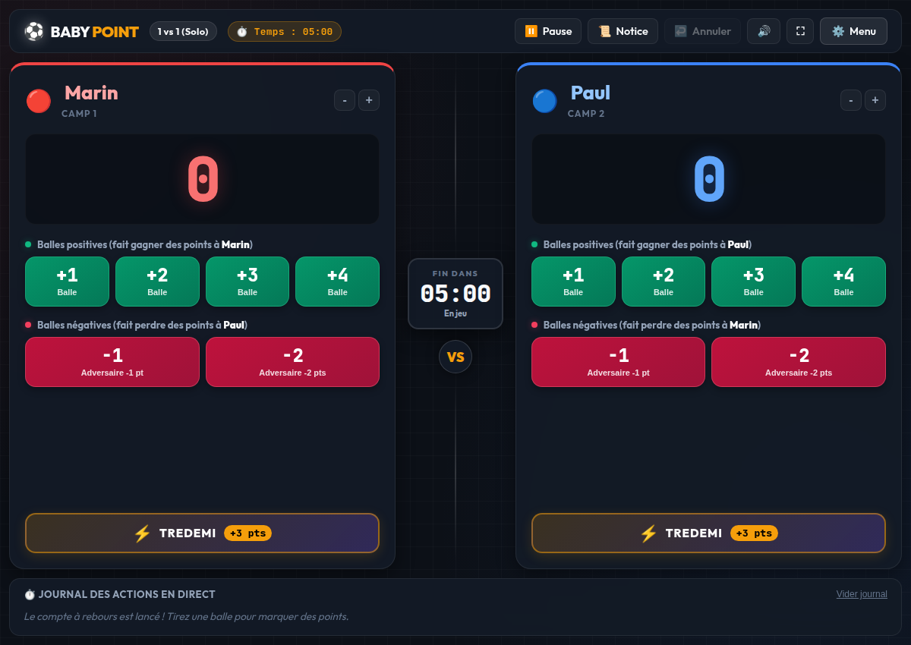
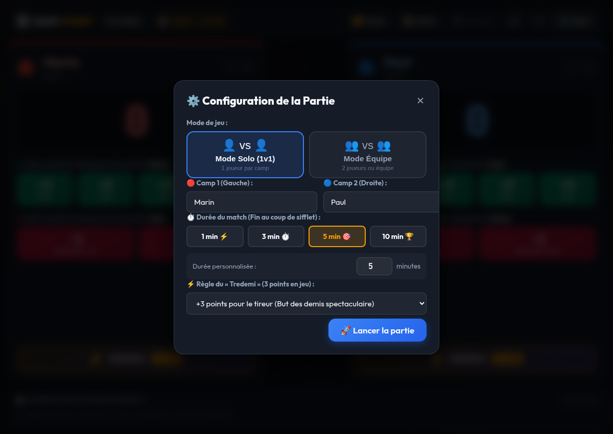

# ⚽ Baby Point - Logiciel de Comptage & Chronomètre de Match

Application web moderne en HTML, CSS et JavaScript pur (sans dépendance externe, 100% autonome et hors-ligne) pour arbitrer et compter les points du jeu **Baby Point**.



---

## 🚀 Comment lancer le jeu

Double-cliquez simplement sur le fichier **`index.html`** pour l'ouvrir dans votre navigateur web (Google Chrome, Firefox, Safari, Edge).

Vous pouvez également lancer le jeu via le terminal :
```bash
xdg-open index.html
```

---

## 🎯 Règles du jeu intégrées

### 1. Types de balles
- **Balles positives (+1, +2, +3, +4)** : Lorsqu'un joueur tire une balle positive dans le camp adverse, **il gagne les points inscrits sur la balle**.
- **Balles négatives (-1, -2)** : Lorsqu'un joueur tire une balle négative dans le camp adverse, **l'adversaire perd 1 ou 2 points** (et passe en score négatif s'il était à 0 : *"Moins un point"*).
- **Règle des demis (« Tredemi »)** : Fonctionne comme les demis au baby-foot avec **3 points en jeu** (bouton dédié `⚡ TREDEMI (+3 pts)`).

### 2. Durée & Fin de partie au compte à rebours
- Pas de score cible fixe : le match se dispute au **compte à rebours** (1 min, 3 min, 5 min, 10 min ou durée personnalisée).
- À 00:00, le **triple coup de sifflet d'arbitre retentit**, les scores sont automatiquement verrouillés.
- **Victoire** : Célébration spectaculaire avec pluie de confettis et trophée pour le vainqueur.
- **Match Nul** : En cas d'égalité, célébration festive du match nul avec proposition immédiate de prolongations (+1 min en mort subite) !

| Configuration du match | Célébration de Victoire |
| :---: | :---: |
|  |  |

---

## ⌨️ Commandes & Ergonomie
- **Annuler** : bouton ↩️ Annuler ou raccourci clavier `Ctrl + Z`.
- **Pause / Reprendre** : bouton ⏸️ Pause ou touche `Espace`.
- **Plein écran** : bouton ⛶ pour un affichage immersif sur PC ou tablette.
- **Personnalisation des noms** : cliquez directement sur les noms des joueurs pour les modifier en temps réel.
