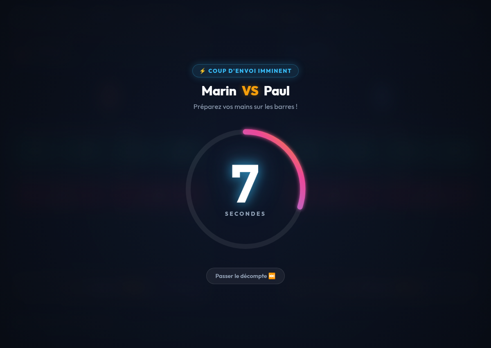
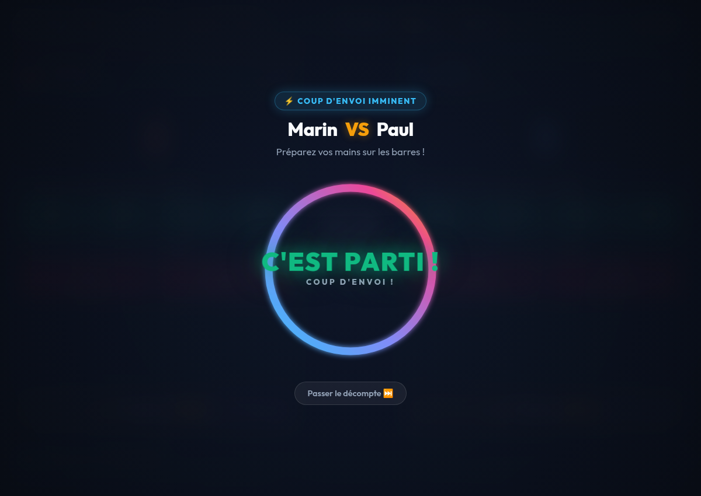

# ⚽ Baby Point - Logiciel de Comptage & Chronomètre de Match

Application web moderne en HTML, CSS et JavaScript pur (sans dépendance externe, 100% autonome et hors-ligne) pour arbitrer et compter les points du jeu **Baby Point**.

🌐 **Jouer en ligne immédiatement** : [https://mdp2014.github.io/BabyPoint/](https://mdp2014.github.io/BabyPoint/)


---

## 🚀 Comment lancer le jeu

Double-cliquez simplement sur le fichier **`index.html`** pour l'ouvrir dans votre navigateur web (Google Chrome, Firefox, Safari, Edge).

Vous pouvez également lancer le jeu via le terminal :
```bash
xdg-open index.html
```

---

## 🎯 Modes de jeu disponibles

- **Mode Solo (1v1)** : 1 joueur contre 1 joueur (Marin vs Paul).
- **Mode Asymétrique (1v2)** : 1 joueur tout seul contre une équipe de 2 joueurs (nom du joueur solo + nom de l'équipe des 2 joueurs).
- **Mode Équipe (2v2)** : 2 équipes s'affrontent.

---

## ⏱️ Compte à rebours animé de coup d'envoi (10 secondes)

Au lancement d'une partie ou lors d'une revanche, un **compte à rebours immersif de 10 secondes** se déclenche :
- **Grand anneau circulaire néon** : Se remplit de façon continue et fluide au rythme des secondes qui s'écoulent.
- **Chiffre central dominant** : Chaque seconde (10, 9, 8... 1) est mise en valeur par une animation dynamique de grossissement (*scale pop*), d'apparition fluide et une onde de choc lumineuse.
- **Bips sonores aigus** : Chaque chiffre est rythmé par un bip sonore aigu (Web Audio API) pour faire monter la tension, avec des tonalités encore plus aiguës sur 3, 2, 1.
- **Coup d'envoi explosif** : À 0, affichage triomphal de **« C'EST PARTI ! »** accompagné du coup de sifflet d'engagement, avant le lancement direct du chronomètre de match.
- **Touche passer** : Bouton `Passer le décompte ⏭️` (ou touche `Espace` / `Échap`) pour démarrer immédiatement si souhaité.

| Décompte en cours (7s) | Coup d'envoi (C'est parti !) |
| :---: | :---: |
|  |  |

---

## 📋 Règles du jeu intégrées

### 1. Types de balles
- **Balles positives (+1, +2, +3, +4)** : Lorsqu'un joueur tire une balle positive dans le camp adverse, **il gagne les points inscrits sur la balle**.
- **Balles négatives (-1, -2)** : Lorsqu'un joueur tire une balle négative dans le camp adverse, **l'adversaire perd 1 ou 2 points** (et passe en score négatif s'il était à 0 : *"Moins un point"*).
- **Règle des demis (« Tredemi »)** : Fonctionne comme les demis au baby-foot avec **3 points en jeu** (bouton dédié `⚡ TREDEMI (+3 pts)`).

### 2. Durée & Fin de partie au compte à rebours
- Pas de score cible fixe : le match se dispute au **compte à rebours** (1 min, 3 min, 5 min, 10 min ou durée personnalisée).
- À 00:00, le **triple coup de sifflet d'arbitre retentit**, les scores sont automatiquement verrouillés.
- **Victoire** : Célébration spectaculaire avec pluie de confettis et trophée pour le vainqueur.
- **Match Nul** : En cas d'égalité, célébration festive du match nul avec proposition immédiate de prolongations (+1 min en mort subite) !

### 3. Interdictions & Fautes
- **Interdiction de la Roulette** : Dès qu'un joueur fait une roulette, **il perd automatiquement 2 points** (à déduire manuellement via le bouton `-` de son camp).
- **Tir depuis le Goal** : Dès qu'on marque directement du goal (gardien), **le but ne rapporte aucun point** (0 point ajouté).

| Configuration du match | Célébration de Victoire |
| :---: | :---: |
|  |  |

---

## ⌨️ Commandes & Ergonomie
- **Commande Vocale « Hé Baby »** : bouton 🎙️ dans l'en-tête pour activer/désactiver le micro.
- **Annuler** : bouton ↩️ Annuler ou raccourci clavier `Ctrl + Z`.
- **Pause / Reprendre** : bouton ⏸️ Pause ou touche `Espace`.
- **Plein écran** : bouton ⛶ pour un affichage immersif sur PC ou tablette.
- **Personnalisation des noms** : cliquez directement sur les noms des joueurs pour les modifier en temps réel.

---

## 🎙️ Guide de la Commande Vocale Intelligente « Hé Baby »

Contrôlez les scores à la voix sans jamais lâcher les poignées du baby-foot !

- **⚡ Activation automatique au démarrage** : La commande vocale s'active automatiquement dès l'ouverture de l'application et au démarrage du match. Vous pouvez la couper ou la réactiver à tout moment d'un clic sur le bouton 🎙️ dans l'en-tête.
- **🧠 Moteur vocal ultra-intelligent & tolérant** :
  - **Reconnaissance phonétique avancée** : comprend *« Hé Baby »*, *« Hey Baby »*, *« Et Baby »*, *« Eh Baby »*, ainsi que les transcriptions fréquentes de Google *« Bébé »*, *« Hé Bébé »*, *« Et Bébé »*, *« Babi »*, *« BB »*.
  - **Flux en continu (Streaming)** : détection ultra-rapide sans temps d'attente, affichage en direct dans le bandeau de ce qui est entendu.
  - **Évaluation multi-hypothèses** : analyse simultanée de plusieurs alternatives phonétiques pour ne jamais rater un ordre.
  - **Watchdog anti-coupure** : maintien en vie automatique du micro pour éviter toute déconnexion silencieuse en arrière-plan.
- **🗣️ Formules naturelles reconnues (parlez comme vous jouez !)** :
  - `« Hé Baby, 1 pour bleu »` ou `« Hé Baby, +1 pour bleu »` ➔ +1 point pour Bleu 🔵
  - `« Hé Baby, deux pour rouge »` ou `« Hé Baby, +2 pour rouge »` ➔ +2 points pour Rouge 🔴
  - `« Hé Baby, -2 pour bleu »` ou `« moins deux à Paul »` ➔ Retire 2 points à Bleu 🔵
  - `« Hé Baby, ajoute 3 points à Marin »` ➔ +3 points pour Marin 🔴
  - `« Hé Baby, roulette pour bleu »` ➔ Applique automatiquement la pénalité Roulette (-2 points) !
  - `« Hé Baby, Tredemi bleu »` ➔ Applique immédiatement la règle des demis (+3 points) !
  - `« Hé Baby, pause »`, `« Hé Baby, reprendre »`, `« Hé Baby, annuler »`.
- **📱 Navigateurs compatibles** : Google Chrome (PC, Mac, Android), Microsoft Edge et Safari.
